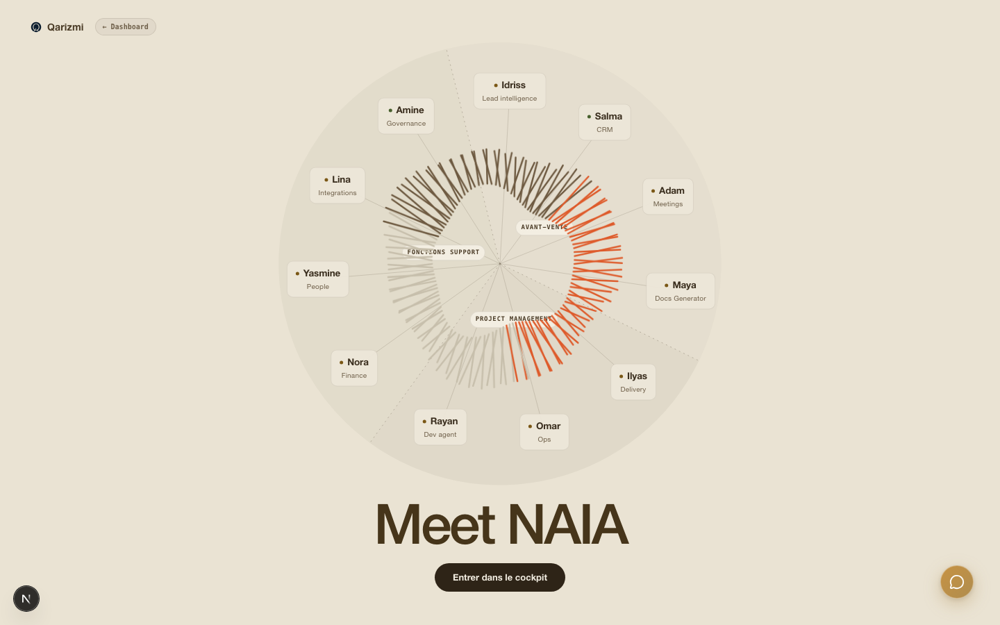
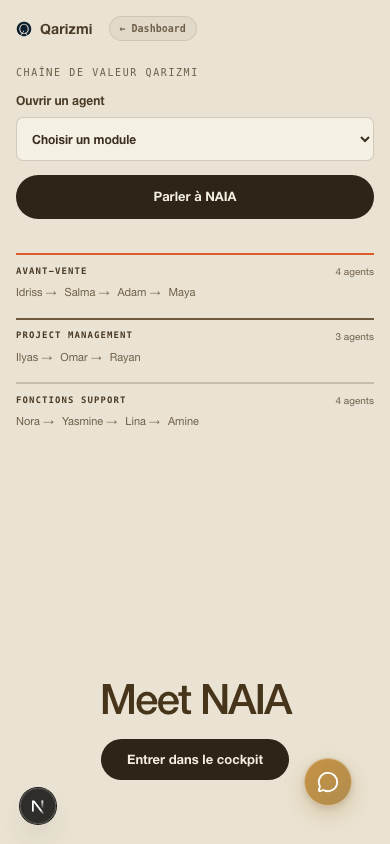
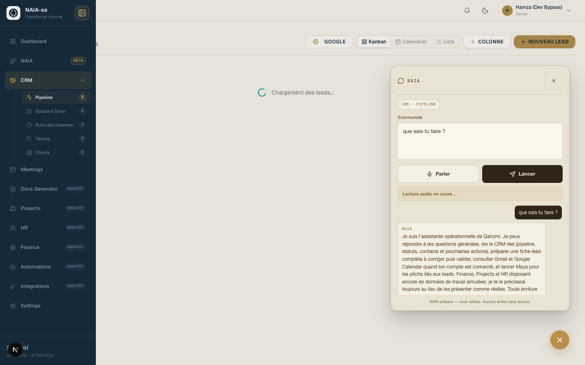
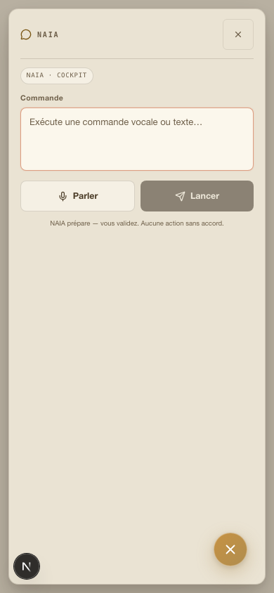

# NAIA Redesign Finalization

## Scope

Finalisation du redesign Maison livré dans la PR #81, sans remplacer les
composants ni les workflows live existants.

- Galaxie plein écran et responsive.
- Navigation des 11 agents vers leurs modules opérationnels.
- Assistant NAIA flottant, déplaçable et persistant pendant la navigation.
- Contexte de page typé, borné et revalidé côté serveur.
- Voix officielle pilotée par `ELEVENLABS_VOICE_ID`.
- Validation humaine conservée avant toute écriture ou action externe.

## Captures

### Accueil desktop - 1440 x 900

### Accueil mobile - 390 x 844

### Assistant contextuel sur le CRM

### Assistant mobile

## Matrice Produit

| Agent / module             | Statut               | Données et garde-fous                                                      |
| -------------------------- | -------------------- | -------------------------------------------------------------------------- |
| NAIA / Orchestrateur       | Live                 | Questions, routage, conversation et actions signées avec validation        |
| Salma / CRM                | Live                 | Pipeline Supabase, filtres, lead sélectionné et formulaire de validation   |
| Adam / Meetings            | Live sous connexion  | CRM live et Google Workspace lorsque le compte est connecté                |
| Maya / Docs Generator      | Live sous permission | Cofondateurs uniquement, génération et dépôt Drive privés                  |
| Amine / Settings           | Live                 | Gouvernance, statut des intégrations et configuration voix masquée         |
| Lina / Integrations        | Guarded              | État des connecteurs live, effets externes soumis aux permissions          |
| Idriss / Lead Intelligence | Simulated            | Données de prospection de travail, explicitement signalées                 |
| Nora / Finance             | Simulated            | Prévisions de travail sur données simulées                                 |
| Ilyas / Projects           | Simulated            | Portfolio et risques de travail sur données simulées                       |
| Yasmine / HR               | Simulated            | Staffing et recrutements de travail sur données simulées                   |
| Omar / Automations         | Guarded              | Cockpit et approbations disponibles, connecteurs selon configuration       |
| Rayan / Dev Agent          | Deferred             | Raccourci vers Automations, aucune écriture de code autonome en production |

## Contrat De Contexte

Le navigateur transmet uniquement un contexte structuré :

- route, module et vue ;
- filtres autorisés ;
- identifiant et type de l'entité sélectionnée ;
- mode `live` ou `simulated`.

Le serveur reconstruit le module depuis la route, rejette les vues, filtres et
types d'entités non autorisés, puis recharge les données accessibles à
l'utilisateur. Aucun texte du DOM n'est transmis.

Priorité appliquée :

1. Instruction explicite.
2. Entité sélectionnée.
3. Module et vue.
4. Historique privé de conversation.
5. Contexte Qarizmi général.

## Validation

- Matrice contractuelle des 11 destinations.
- Navigation navigateur : Salma vers le CRM et Adam vers Meetings.
- Assistant visible sur `/naia`, le CRM et Meetings.
- Conversation conservée après navigation.
- Contexte CRM global, filtres et lead sélectionné.
- Instruction explicite prioritaire sur l'entité sélectionnée.
- Entité et filtres périmés supprimés au changement de route.
- Contexte privé protégé par authentification et non transmis aux canaux Slack partagés.
- Identifiant de voix client ignoré ; voix officielle et fallback uniquement côté serveur.
- Contrôles visuels en 1440 x 900 et 390 x 844, sans overflow ni overlap.
- `npm run ci` : 58 fichiers, 478 tests, lint, types et build Next.js verts.

En local sans secrets ElevenLabs, le test navigateur vérifie l'avertissement de
fallback. La Preview Vercel valide la configuration réelle de l'environnement.
